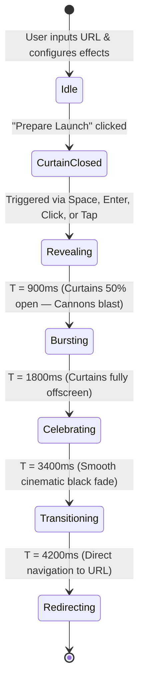

# 🎭 CurtainCall

<p align="center">
  <strong>Every great website deserves a grand opening.</strong>
</p>

<p align="center">
  A theatrical web experience that turns destination URL navigation into an unforgettable cinematic premiere: heavyweight red velvet curtains part on command, real-time volumetric stage lights sweep across the stage, celebration confetti erupts, and users transition seamlessly to your website.
</p>

<p align="center">
  
  
  
  
  
</p>

---

## ✨ Features

- 🎭 **Ultra-Realistic Velvet Drapery**
  - 11 organic 3D pinch-pleat vertical folds with natural cylindrical highlights and crease shadows.
  - Decorative top valance with micro-swaying gold bullion fringe.
  - Stranded gold hanging tassels with responsive physics.
  - Smooth 1.8s physical fabric slide with inertia and easing offscreen.

- 💡 **Real-Time Volumetric Lighting Engine**
  - High-performance HTML5 Canvas rendering engine with additive optical blending (`globalCompositeOperation: screen`).
  - Three distinct lighting profiles:
    - **Warm Glow**: Golden Broadway followspot & warm candlelight footlights.
    - **Grand Stage**: Chiaroscuro diagonal amber and royal midnight-blue cross-beams + overhead soliloquy moonlight pin-spot.
    - **Spectacular**: 7 cathedral god rays, sweeping moving-head profiles, and champagne center wash.
  - Rolling stage floor haze and dry-ice fog puffs.

- 🎉 **70% Screen Multi-Cannon Confetti**
  - High-density particle system powered by `canvas-confetti`.
  - 5 synchronized party-popper cannons covering the middle 70% viewport.
  - Cascading waves: perimeter inward shoots, mid-air radial bursts, and high-altitude star & foil rain.
  - 3 density levels: *Gentle Flutter*, *Balanced Spread*, and *Grand Celebration*.

- 🎛️ **Google Material 3 Dark UI**
  - Polished launch console inspired by Material Design 3.
  - Segmented control pills and luxury switch toggles.
  - Adaptive fluid typography with single-line headline optical sizing.

- ⌨️ **Accessibility & Responsive Input**
  - Keyboard accessible (<kbd>Space</kbd> or <kbd>Enter</kbd> to raise curtains).
  - Mouse click and immediate touch support for mobile & tablet.
  - Respects `prefers-reduced-motion` settings across fabric physics, canvas lights, and overlays.
  - Locks background scrolling during stage reveals.

---

## 🎬 Launch Sequence Choreography

CurtainCall runs a carefully timed state machine to create anticipation:



---

## 🛠️ Tech Stack

| Technology | Purpose |
|---|---|
| **React 19** | Component architecture & state orchestration |
| **TypeScript 6** | Full type safety across sequence states and effect settings |
| **Vite 8** | Next-generation bundler with instant HMR and tiny build artifacts |
| **canvas-confetti** | Hardware-accelerated canvas particle physics |
| **Vanilla CSS** | Zero-runtime CSS custom properties with GPU-accelerated transforms |
| **HTML5 Canvas 2D** | Real-time volumetric spotlight ray-marching & fog simulation |

---

## 🚀 Getting Started

### Prerequisites

- **Node.js** `>= 18.0.0`
- **npm** `>= 9.0.0`

### Installation

1. **Clone the repository:**
   ```bash
   git clone https://github.com/your-username/curtaincall.git
   cd curtaincall
   ```

2. **Install dependencies:**
   ```bash
   npm install
   ```

3. **Start local development server:**
   ```bash
   npm run dev
   ```
   *Windows PowerShell Note: If you encounter an execution policy prompt, run `Set-ExecutionPolicy -Scope CurrentUser -ExecutionPolicy RemoteSigned -Force` once in PowerShell.*

4. Open `http://localhost:5173` in your browser.

---

## 📦 Scripts

| Command | Description |
|---|---|
| `npm run dev` | Starts Vite local development server on port 5173 |
| `npm run build` | Runs TypeScript type check and creates production build in `dist/` |
| `npm run preview` | Previews the production bundle locally |
| `npm run lint` | Runs `oxlint` for high-speed static analysis |

---

## 📂 Project Structure

```text
src/
├── assets/                  # Icons and static resources
├── components/
│   ├── ConfettiCelebration/ # Multi-burst canvas particle cannons
│   ├── CurtainStage/        # Fullscreen stage container & keyboard/touch listener
│   ├── LaserLightShow/      # Volumetric canvas lighting engine (god rays, haze, pools)
│   ├── LaunchForm/          # Google Material 3 input form & stage effects card
│   ├── RevealInstructions/  # Overlay badge & prompt when curtains are closed
│   └── VelvetCurtain/       # Natural 3D velvet drapery, pleats, valance & tassels
├── hooks/
│   └── useLaunchSequence.ts # URL normalization & deterministic timeline state machine
├── types/
│   └── index.ts             # LaunchState, LaunchSettings & session interfaces
├── App.tsx                  # Root component orchestrating screen flow & navigation
├── App.css                  # Ambient background lighting & orb drifting
├── index.css                # Google Material 3 tokens, reset & scrollbar
└── main.tsx                 # React entry point
```

---

## ⚙️ Configuration & Customization

The stage effects can be configured directly from the UI or adjusted via `DEFAULT_LAUNCH_SETTINGS` in [src/types/index.ts](src/types/index.ts):

```typescript
export interface LaunchSettings {
  popperEnabled: boolean;
  popperIntensity: 'subtle' | 'standard' | 'grand';
  lightShowEnabled: boolean;
  lightShowIntensity: 'ambient' | 'concert' | 'extreme';
}
```

### Confetti Intensities
- **Subtle** — Gentle flutter of ~350 soft metallic flakes.
- **Balanced** — 5 synchronized cannons bursting across 70% of the screen.
- **Grand** — 1,000+ dense flakes, rotating stars, and streamer ribbons.

### Lighting Presets
- **Warm Glow (`ambient`)** — Warm amber key followspot and glowing candle footlights.
- **Grand Stage (`concert`)** — Chiaroscuro cross-wash beams (theatrical amber + royal blue) with a moonlight downlight.
- **Spectacular (`extreme`)** — 7 cathedral god rays, moving profile sweepers, and intense champagne floor pools.

---

## 🌐 Deployment

### Vercel / Netlify
Both platforms automatically detect Vite. Set the build command to `npm run build` and the output directory to `dist`.

### GitHub Pages
1. Install `gh-pages`:
   ```bash
   npm install -D gh-pages
   ```
2. Set `base: '/<repository-name>/'` in `vite.config.ts`.
3. Add deploy script to `package.json`:
   ```json
   "scripts": {
     "deploy": "npm run build && gh-pages -d dist"
   }
   ```
4. Run:
   ```bash
   npm run deploy
   ```

---

## 🤝 Contributing

Contributions, issues, and feature requests are welcome!
Feel free to open an issue or submit a pull request.

1. Fork the Project
2. Create your Feature Branch (`git checkout -b feature/AmazingFeature`)
3. Commit your Changes (`git commit -m 'Add some AmazingFeature'`)
4. Push to the Branch (`git push origin feature/AmazingFeature`)
5. Open a Pull Request

---

## 📄 License

Distributed under the **MIT License**. See `LICENSE` for more information.

---

<p align="center">
  Crafted with theatrical drama & precision engineering. 🎭
</p>
